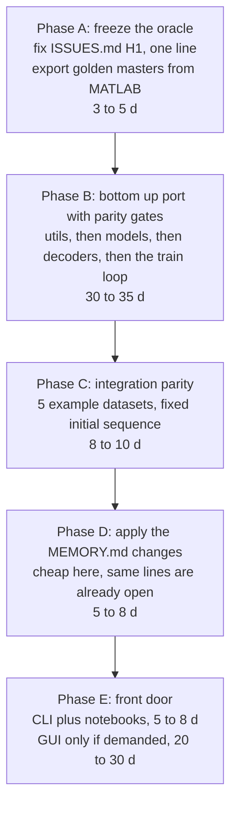

# Effort to move BSD to Python

An estimate, as asked, not a plan of record. 15 October 2026, branch `rev/review`.

Basis: the measured inventory in `SYSTEM.md` section 5, the call graph read while writing that
document, and the defect list in `ISSUES.md`. No code was written and nothing was benchmarked.
Effort is in **engineer days** for one engineer who is fluent in both MATLAB and the scientific
Python stack and who did **not** write the original. Section 7 lists what would move these numbers.

---

## 1. The headline

| Scope | What you get | Effort | Calendar at 60 percent focus |
|---|---|---|---|
| **S1. Numerics only** | An importable library: HMM and HSMM, the two live Gaussian emission models, the two live duration models, transition and initial models, both decoders, both Viterbis, the train loop, multi block sharing. Parity tested against MATLAB. No UI. | **53 to 62 d** | about 2.5 to 3 months |
| **S2. S1 plus the rest of the model zoo and a usable front door** | the four MAR emission models, the categorical duration model, a CLI and worked notebooks replacing the GUI | **73 to 90 d** | about 3.5 to 4.5 months |
| **S3. S2 plus a GUI** | a web or desktop app covering the documented workflow | **95 to 135 d** | about 5 to 7 months |

Add **20 to 30 percent contingency** on any of these. This is undocumented research code with no
tests, so the discovery cost is real and it is front loaded. The contingency is already inside the
ranges above for S1, and is not for S2 and S3.

**Recommendation: S2, and do not port the GUI.** The GUI is 3,548 lines and 122 nested callbacks,
it is 35 percent of the codebase, it contains none of the science, and two of its defects are
already in `ISSUES.md`. A CLI plus three worked notebooks delivers the documented workflow for a
tenth of the cost and is what a Python user would expect anyway.

---

## 2. Component by component

LOC are non blank, non comment, measured on this branch. Rates assumed: about 50 lines a day for
the numerical core, because every line needs an oracle comparison; about 120 to 150 a day for
model classes and plumbing; library substitution is costed as integration, not translation.

| Component | LOC | Methods | Port target | Effort | Risk |
|---|---|---|---|---|---|
| `+inference/hsmmresidual_decodelog.m` | 123 | 1 | numpy, einsum or explicit loops | **8 to 10 d** | **high**, see 4.2 |
| `+inference/hmm_decodelog.m`, `hmm_decode.m` | 93 | 2 | numpy | 2 d | low |
| `+inference/hsmmresidual_decode.m` | 103 | 1 | optional, it is the unused linear twin | 0 to 2 d | low |
| `+inference/hsmmresidual_logviterbi.m` | 110 | 1 | numpy, and redesign while porting | 5 to 7 d | medium |
| `+inference/hmmviterbi.m` | 67 | 1 | numpy | 1 d | low |
| `+inference/train.m`, `trainn.m` | 409 | 2 | a `fit` function plus a `Study` object | 6 to 8 d | medium |
| `hsmm.m`, `hmm.m` | 300 | 25 | two dataclass backed model classes | 3 d | low |
| `multimodel.m`, `singletomulti.m` | 154 | 9 | a group model over a dict of blocks | 3 to 4 d | medium, the `eval` based access must be rewritten |
| `+emis_model/normal_normal_wishart.m` | 243 | 13 | numpy and scipy | 4 d | medium, the Wishart algebra needs care |
| `+emis_model/normal_normal_gamma.m` | 242 | 13 | numpy and scipy | 2 d | low, once the first one is done |
| `+dur_model/normal_normal_gamma.m`, `lognormal_normal_gamma.m` | 433 | 26 | numpy and scipy | 4 d | medium, the truncation decision must be settled, `ISSUES.md M9` |
| `+trans_model` ×2, `+in_model` ×1 | 292 | 36 | numpy, three small classes | 3 d | low |
| `+util` log domain and KL helpers | about 300 | 14 | `scipy.special.logsumexp`, hand written KLs | 3 d | low |
| `+util` initialisation, `initvb`, `unirndseq`, `decodevarinit` | about 130 | 3 | numpy, plus scikit-learn for k means | 3 d | medium, `decodevarinit` has a latent index bug, `ISSUES.md H5` |
| `+util` multi block, `groupindex`, `inmatr`, `outmatr`, `addmodel` | about 100 | 4 | replaced outright by a dict keyed on `(cond, subj, block)` | 3 d | medium, replacement not translation |
| `+util/kmeans2015.m` | 538 | — | **delete**, call `sklearn.cluster.KMeans` | 0.5 d | low, and it removes a licensing question |
| `+util/+spm/*` | 359 | 8 | `numpy.linalg.slogdet`, `statsmodels` RLM | 2 d | low |
| `+util` plotting, 15 files | about 350 | 10 | matplotlib, and MNE for topographies | 4 to 6 d | low |
| `.mat` and study IO | — | — | `scipy.io.loadmat`, `h5py` | 3 to 4 d | medium, the nested struct arrays are fiddly |
| Oracle and parity harness | — | — | pytest, plus a MATLAB export script | **10 to 14 d** | this is what makes the port trustworthy |
| Packaging, CI, docs, examples | — | — | `pyproject.toml`, GitHub Actions, three notebooks | 5 to 7 d | low |
| **S1 subtotal** | **about 2,900 live LOC** | | | **53 to 62 d** | |
| `+emis_model/mar*.m` ×4 | 1,447 | 70 | one class, not four, once the team says which is current | 10 to 14 d | **high**, four near duplicates and no documentation |
| `+dur_model/categ_dirichlet.m` | 127 | 8 | numpy | 2 d | low, but it is currently unreachable, `ISSUES.md H2` |
| CLI plus notebooks | — | — | `typer` or `argparse`, three notebooks | 5 to 8 d | low |
| **S2 subtotal** | | | | **73 to 90 d** | |
| `uiBSD.m` | 3,548 | 122 | Streamlit or Dash, documented workflow only | 20 to 30 d | medium |
| `uiBSD.m`, full parity | 3,548 | 122 | PyQt | 40 to 60 d | high, and not recommended |
| **S3 subtotal** | | | | **95 to 135 d** | |

---

## 3. Library mapping

Almost every MATLAB dependency has a direct Python counterpart, which is why this port is an
estimate rather than a research project.

| MATLAB | Python | Note |
|---|---|---|
| `psi` | `scipy.special.digamma` | `digamma(0)` is `-inf` in both, which the zero diagonal transition trick relies on, test it explicitly |
| `gammaln`, `mvtGammaln` | `scipy.special.gammaln`, `multigammaln` | |
| `mvnpdf` | `scipy.stats.multivariate_normal.logpdf` | use the log form, not the exponentiated one |
| `mvnrnd`, `gamrnd`, `iwishrnd` | `numpy.random.Generator`, `scipy.stats.invwishart` | streams differ, see 4.6 |
| `util.Dirichlet.dirichletRnd` | `numpy.random.Generator.dirichlet` | |
| `util.kmeans2015` | `sklearn.cluster.KMeans` | deletes 538 vendored lines |
| `pca` | `sklearn.decomposition.PCA` | sign conventions of components differ, fix a convention |
| `hilbert`, `resample` | `scipy.signal.hilbert`, `scipy.signal.resample_poly` | **different filter design**, so the preprocessed data will not match MATLAB bit for bit. Compare after this step, not through it |
| `spm_logdet` | `numpy.linalg.slogdet` | plus the rank deficient fallback |
| `spm_robust_glm` | `statsmodels.robust.robust_linear_model.RLM` | different weighting defaults, check against the SPM version |
| `topoplot`, EEGLAB | `mne.viz.plot_topomap` | removes the undeclared EEGLAB dependency |
| `parfor` | `joblib.Parallel` | and do not oversubscribe, `MEMORY.md` 3.1 |
| `VideoWriter` | `imageio` | only used by the `graf` path |
| `load`, `save` of `.mat` | `scipy.io.loadmat`, `h5py` for v7.3 | the example files are v5, parsed successfully during this review |
| `uicontrol`, GUIDE | Streamlit, Dash or PyQt | a rewrite, not a port |

Nothing in the numerical core needs a dependency that does not exist. There is no MATLAB specific
numerical capability in play.

---

## 4. Where a port of this particular codebase goes wrong

These are the places that turn a two week estimate into a two month one. They are specific to this
code, not generic advice.

### 4.1 The options script has no Python equivalent

`program_option.m` is a **script**, run inside the caller's own scope by `train`, `trainn` and all
four decoders, for example `+inference/train.m:19`. It injects a variable named `opt` by text.
Python has nothing like it, and should not. It becomes a frozen dataclass with explicit defaults,
which is an improvement, but it means every function signature along the path changes and the
`setfield` override pattern at `train.m:32-34` has to be replaced with something typed. Budget this
as design work early, because everything else depends on it.

### 4.2 Column major reshape, the highest risk 12 lines in the project

`+inference/hsmmresidual_decodelog.m:61-72` builds the duration statistic with a chain of
`repmat`, `repelem`, `reshape`, `permute` and `squeeze`. It is correct, and it is correct **because
MATLAB is column major**. numpy is row major by default, so a literal transliteration is silently
wrong, not loudly wrong, and the error shows up as a slightly mis-shaped duration posterior that
still looks plausible.

Two ways through: pass `order='F'` everywhere and keep the structure, or discard the structure and
re-derive the statistic with `numpy.einsum`, which is what I would do, since the quantity is
`durcount[d,j] = logsumexp_i( alphax[i] + A[i,j] + zdur[j,d] )`. Either way, **this is the one
place that needs an element wise oracle comparison on a tiny case before anything else is ported.**
Budget 3 of the 8 to 10 days for the log decoder on these 12 lines alone.

### 4.3 Implicit array growth, which the port will turn into crashes

MATLAB grows an array when you assign past its end. numpy raises. Three places rely on growth:
`logviterbi:84` builds `sa` that way, `decodevarinit.m:39` can write at `dmax+1`, and
`renameseq.m:6` sizes `seq` wrongly and relies on growth. In Python, the second becomes an
`IndexError`, which is **good news**: the port surfaces `ISSUES.md H5` immediately instead of
hiding it. Expect two or three such discoveries and leave room for them.

### 4.4 Handle class semantics

All the model classes are `handle`, so they alias, and the code leans on that: `trainn` mutates
the model passed to it, `train.m:64` then copies the winner back into the caller's object. Each
class hand rolls a `copy` method, and one of them does not clear what it says it clears,
`ISSUES.md M10`. In Python everything is a reference already, so the aliasing works, but every
`copy`, `copytrain` and `cleanpos` has to be re-derived deliberately with `copy.deepcopy` or an
explicit `replace`. Do not transliterate these three methods, re-specify them.

### 4.5 `eval` based struct access

`+util/inmatr.m` and `outmatr.m` build field access as strings and `eval` them, including dotted
paths such as `'decodevar.gamma'`. There is no sane Python equivalent and no reason to want one.
Replace the whole nested `cond.subj.block` struct with a dictionary keyed on the tuple
`(cond, subj, block)`, which also makes the sharing groups in `groupindex` a one line
`itertools.groupby`. This is a replacement of about 100 lines by about 30, and it is one of the
places where the Python version will be clearly better than the original.

### 4.6 Bit identical parity is impossible, so do not aim for it

Three reasons: the random streams differ, `scipy.signal.resample_poly` does not design the same
filter as MATLAB's `resample`, and the default initialisation is random with no seed control,
`ISSUES.md M15`. Parity tests must therefore **fix the initial state sequence** and compare
downstream, rather than fix a seed. Tolerances of `1e-10` are achievable for the deterministic
parts, the decoders and the M steps, and that is where the value is.

### 4.7 Port the model, not the bugs

A straight transliteration would carry `M1`, the wrong `2*pi` constant, `M5`, the normalisation at
a hard coded time index, and `M9`, the duration truncation mismatch, into the new codebase, where
they will be harder to spot because the new code will look clean. The right approach is a
`legacy=True` flag that reproduces the MATLAB arithmetic exactly, used only for comparing against
published results, with the corrected path as the default. Budget 2 to 3 days inside S1 for that
switch. It is the difference between a port and a laundering.

---

## 5. Suggested sequence

Two notes on sequencing.

- **Phase A is not optional.** Without a reference that runs, the port has nothing to be compared
  against, and `ISSUES.md H1` means the HSMM path currently does not run with shipped defaults. One
  line of MATLAB unblocks the entire project.
- **Phase D is cheaper inside the port than after it.** The memory work in `MEMORY.md` touches
  exactly the lines Phase B rewrites, and numpy makes checkpointing and streaming statistics
  considerably easier than MATLAB does. Doing both at once saves perhaps 5 days against doing them
  in sequence, which is why the combined S2 plus memory work is roughly 78 to 95 days rather than
  the 95 to 112 you would get by adding the two documents' totals.

## 6. What you gain, beyond Python

Worth stating, since the effort is non trivial and the question was effort rather than merit.

- The 538 vendored MathWorks lines and the SPM helpers disappear into library calls, which removes
  the licensing question in `ISSUES.md M14`.
- No toolbox licences: the current code needs Statistics, Signal Processing and optionally Parallel
  Computing, plus EEGLAB.
- Tests become routine. There is currently no harness at all, see `VALIDATION.md`.
- The memory work gets easier, as above.
- Interoperability with MNE, which is where EEG preprocessing now lives.

## 7. What would move these numbers

| Factor | Effect |
|---|---|
| The team says which MAR and Wishart variants are live | **−10 to −14 d** on S2, and it removes the highest discovery risk |
| A requirement to reproduce published numbers bit for bit | **+30 percent** across the board, and see 4.6, since it may not be attainable at all |
| Dropping the Viterbi path, keeping only `maxgamma` | −5 to −7 d |
| Dropping the multi block sharing feature | −8 to −10 d, but it is the toolbox's most distinctive capability |
| A second engineer | **little gain before Phase C.** The dependency chain in Phase B is mostly serial, and the oracle harness is one person's job. Two engineers help in Phase B for about a 30 percent saving, not 50 |
| No GUI at all, CLI only | **−20 to −30 d** against S3 |
| Access to the original authors for an hour a week | easily worth 10 days, mostly on the questions in `ASSESSMENT.md` section 7 |
