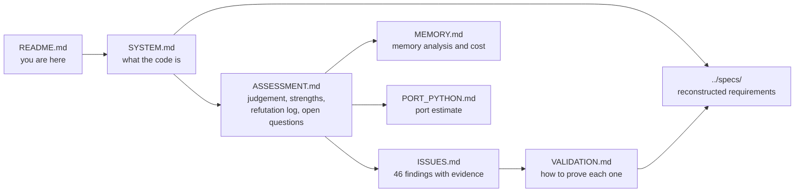

# BSD review

Review of the BSD toolbox, branch `rev/review`, baseline commit `4a89dcc`, 15 October 2026.

**Read only.** Nothing in the toolbox was edited, installed or executed. MATLAB was unavailable in
this session, so **no claim in this folder is `reproduced`**; everything is `read` or `inferred`,
and every document says which. Every line number quoted came from numbered output, never from
counting.

## The six questions, and where each is answered

| Question | Document | Short answer |
|---|---|---|
| What is this code? | [`SYSTEM.md`](SYSTEM.md) | A MATLAB variational Bayes toolbox that segments EEG, MEG, LFP or fMRI into recurring brain states with explicit state durations. Diagrams of the generative model, the inference loop, the E step, the architecture and the EEG pipeline |
| What is wrong, and how do I test it? | [`ISSUES.md`](ISSUES.md), [`ASSESSMENT.md`](ASSESSMENT.md) | 46 findings: High 6, Medium 15, Low 14, Decoration 7, Wish 4. Each has evidence, a condition, a reproduction step and the smallest fix. The issue to test map is [`VALIDATION.md`](VALIDATION.md) section 16 |
| What are the specs? | [`../specs/`](../specs/) | Business rules, 87 requirements in EARS form with implementation status, interface and algorithm specifications, design, and 18 architecture decision records |
| What would it cost to make it memory efficient? | [`MEMORY.md`](MEMORY.md) | **5 engineer days** removes about nine tenths of the problem; **26 to 37 days** makes a 28 participant study comfortable on a laptop. About 90 percent of the memory is retention of results nobody reads |
| What would it cost to move to Python? | [`PORT_PYTHON.md`](PORT_PYTHON.md) | **53 to 62 days** for the numerics with parity tests; **73 to 90** with the full model zoo and a CLI; **95 to 135** with a GUI. Do not port the GUI |
| How should it be validated? | [`VALIDATION.md`](VALIDATION.md) | It never has been: no tests, no assertions, no seed control. **11 to 18 days** buys the safety net, and the keystone is a brute force equivalence test that takes 3 to 5 days |

## Reading order

If you have ten minutes: `ASSESSMENT.md` sections 4 to 8. If you have one hour: add `SYSTEM.md`
and the High section of `ISSUES.md`.

## What to do first

Six engineer days, in this order, each a measurement rather than a change:

1. `ASSESSMENT.md` section 8, the five runs. The first takes a minute and settles `H1`, which is
   whether the HSMM path runs at all with shipped defaults.
2. `VALIDATION.md` tier 0, one to two days, which turns `H1` and `H2` into failing tests forever.
3. `VALIDATION.md` tier 2, the brute force equivalence test, three to five days. Everything else,
   the memory work and the Python port included, is gated on it.

Then decide between the memory work and the port. They overlap: doing the memory changes inside a
port is cheaper than doing them twice, `PORT_PYTHON.md` section 5.

## Standing caveats

- This is somebody else's product code, written by researchers, with context not in the repository.
  Items only the authors can settle are listed as questions, not findings:
  `ASSESSMENT.md` section 7, eight of them.
- The strengths are real and are stated first, in `ASSESSMENT.md` section 4. The four way model
  decomposition, the duration statistic and the sharing design are good work, and the duration
  statistic in particular is correct in a place where it would be easy to be wrong.
- Effort figures are estimates from measured line counts and the call graph, not from benchmarks.
  Each document says what would move its numbers.
