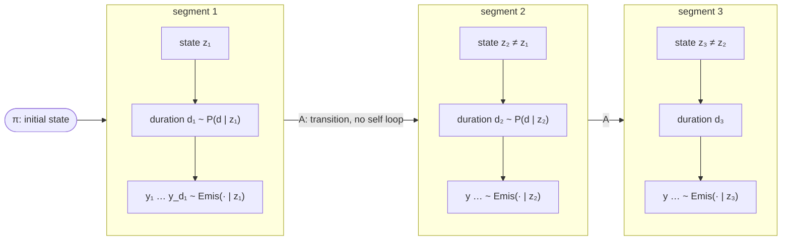
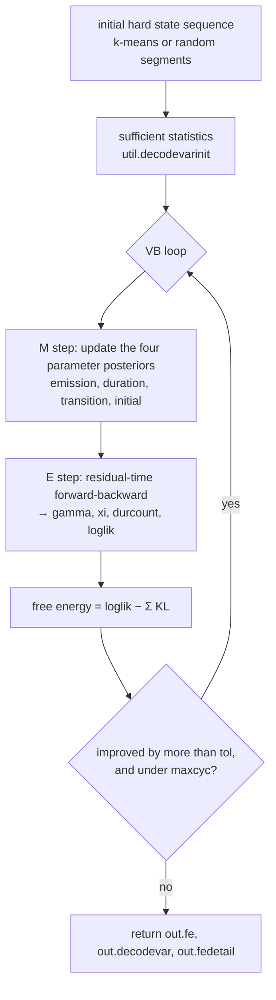
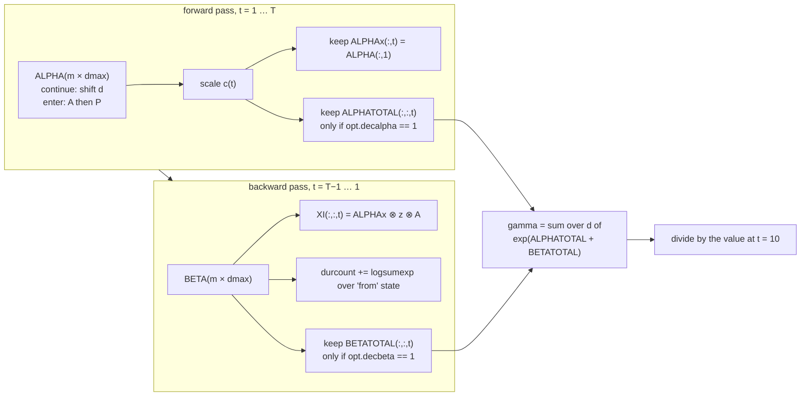
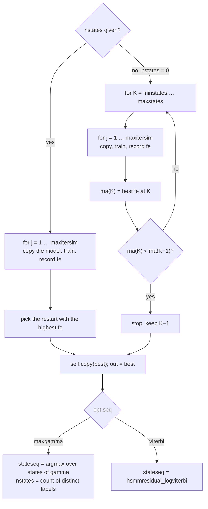
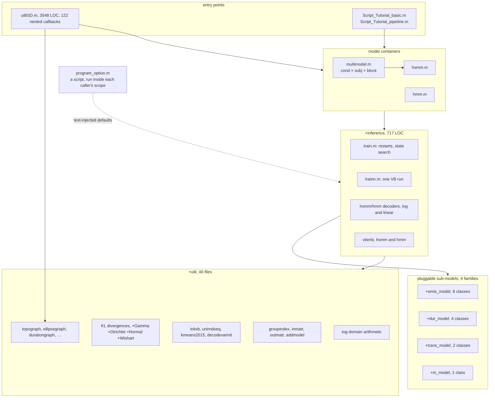
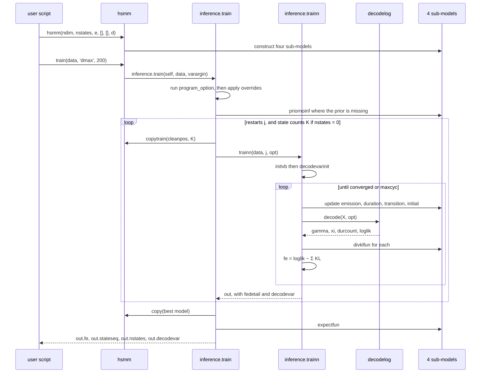
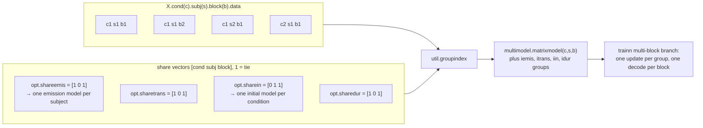
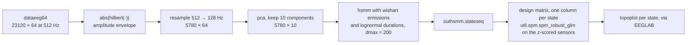

# BSD toolbox: what the code is

An independent description of the system, reconstructed by reading the source. 15 October 2026,
branch `rev/review`, baseline commit `4a89dcc`.

This document describes **what the code does**, not what it should do. Where the implementation
departs from the model it claims to fit, the departure is marked `→ ISSUES.md <id>` and is not
smoothed over. Nothing here was executed: MATLAB was unavailable, so every statement is from
reading, and line citations come from numbered output.

Companion documents: `ISSUES.md` for defects, `VALIDATION.md` for how to prove any of this,
`MEMORY.md` for the memory behaviour, `PORT_PYTHON.md` for a port estimate, `../specs/` for the
reconstructed requirements.

---

## 1. In one paragraph

BSD takes a continuous multivariate brain signal, EEG, MEG, LFP or fMRI, and splits it into a
small number of recurring **states**. Each state is a characteristic spatial pattern of activity
and each visit to a state has a **duration**. The model is fitted by variational Bayes, so the
output is a distribution over parameters rather than a point estimate, plus a per sample
probability of being in each state. The toolbox offers two model families: a hidden Markov model,
where durations are implicitly geometric, and a hidden semi Markov model, where each state has its
own explicit duration distribution. The HSMM is the point of the toolbox.

## 2. The generative model

The model generates data as a sequence of **segments**. Pick a starting state, draw a duration,
emit that many samples from the state's emission model, then jump to a different state and repeat.

Four components, named exactly as the code names them. The manual, section 1.3, uses the same
four names, which is a point in the design's favour.

| Component | Code | Default class | What it parameterises |
|---|---|---|---|
| Emission | `emis_model` | `emis_model.normal_normal_wishart` | the data pattern of each state |
| Duration | `dur_model` | `dur_model.normal_normal_gamma` | how long a visit to each state lasts |
| Transition | `trans_model` | `trans_model.categ_dirichlet_matrixdiag0` | which state follows which |
| Initial state | `in_model` | `in_model.categ_dirichlet` | the state at the first sample |

Defaults from `hsmm.m:25-43`. For the HMM, the transition default is
`trans_model.categ_dirichlet_matrix`, with a free diagonal, `hmm.m:26`, and there is no duration
model.

### 2.1 Why the HSMM transition matrix has a zero diagonal

Once duration is explicit, a self transition would double count: the duration distribution already
says how long the state lasts. So `A(i,i)=0` is correct and deliberate,
`categ_dirichlet_matrixdiag0.m:64` forces the diagonal to zero after each update, and the KL
divergence drops the diagonal element from each row rather than feeding a zero concentration into
the Dirichlet KL, `:105-111`. This is one of the better details in the codebase.

### 2.2 The three emission families

| Family | Class | Model | Parameters, and their priors |
|---|---|---|---|
| Full covariance Gaussian | `normal_normal_wishart` | `y_t ~ N(μ_k, Λ_k⁻¹)` | Normal on `μ`, Wishart on the precision `Λ` |
| Diagonal Gaussian | `normal_normal_gamma` | as above, diagonal `Λ` | Normal on `μ`, Gamma per dimension |
| Multivariate autoregressive | `mar`, `mar2`, `mar3`, `mar4` | `y_t = Σ_{p} W_p y_{t-p} + ε` | Normal Gamma on the coefficients, Wishart on the noise precision |

The MAR family is how the toolbox addresses **connectivity** states rather than amplitude states:
a state is then a pattern of directed lag relationships between channels, not just a mean
topography. `Examples/Example4_Sourcesconn.mat` is the connectivity example. Four near duplicate
MAR variants exist and which is current is an open question, `ASSESSMENT.md` question 6.

### 2.3 The two duration families in use

- `dur_model.normal_normal_gamma`: a Gaussian over duration, evaluated on the integer grid
  `1:dmax` and then renormalised over that grid, `+dur_model/normal_normal_gamma.m:85-92`.
- `dur_model.lognormal_normal_gamma`: a lognormal, which is the better shaped choice for durations
  since it cannot go negative, `+dur_model/lognormal_normal_gamma.m:73-79`. Both tutorials select
  it explicitly, so it is effectively the recommended one.

`dmax` is a hard truncation. Nothing can last longer than `dmax` samples, and `dmax` also sets the
duration prior mean to `dmax/2`, `:187-188`, and the random initialisation's segment lengths,
`+util/unirndseq.m:3`. So `dmax` influences the answer through three separate channels, which is
worth knowing before sweeping it. → `ISSUES.md M13`

---

## 3. Inference: how it is fitted

Mean field variational Bayes. The posterior is factorised into a state part and a parameter part,
and the two are updated alternately until a lower bound on the model evidence, the **free energy**,
stops improving.

Code: the loop is `+inference/trainn.m:50-112`. M step `:57-68`. E step `:70`. Free energy `:86`.
Stopping test `:95-104`.

The quantities passed between the two steps:

| Symbol | Code | Shape | Meaning |
|---|---|---|---|
| `γ` | `decodevar.gamma` | `T × m` | probability of being in each state at each sample |
| `ξ` | `decodevar.xi` | `m × m × T` | probability of each state to state jump at each sample |
| `durcount` | `decodevar.durcount` | `dmax × m` | expected number of entries into each state at each duration |
| `loglik` | `decodevar.loglik` | scalar | log normaliser from the forward pass |

Each M step consumes exactly one of these: emissions use `γ`, the transition matrix uses `ξ`, the
duration model uses `durcount`, and the initial state uses `γ(1,:)`, `trainn.m:57-68`.

### 3.1 The E step, in words

The HSMM is decoded in the **residual time** formulation. The hidden variable is not just the
state but the pair, state and *how many samples are left* in the current visit. That turns a
variable duration model back into a Markov chain on a larger state space, `m × dmax`.

The forward array `ALPHA(i,d)` at time `t` is the joint probability of the data up to `t` and of
being in state `i` with `d` samples still to run. Two things can happen at each step, and the code
is a direct transcription of exactly that, `hsmmresidual_decodelog.m:31-33`:

- **Continue**: you were in state `i` with `d+1` left, you now have `d` left, and you emit.
  That is `w = ALPHA(:,2:dmax) + B(:,t)` in the log domain, a shift of the duration axis.
- **Enter**: the previous visit ended, `d` was 1, so you jump with `A` and draw a fresh duration
  from `P`. That is `x = (A' ⊗ ALPHA(:,1) + B(:,t)) + P`, broadcast across all `d`.

The two are combined with a log sum, `ALPHA = logsumexpmat([w, -inf], x)`, each step is rescaled to
keep the numbers in range, and the sum of the log scale factors is the log likelihood,
`:34-35` and `:99`.

The backward pass mirrors it, `:52-80`, and on the way it accumulates the duration statistic by
building, for each time step, the full `m × m × dmax` array of "entered state `j` with duration `d`
from state `i`" and summing over `i`, `:61-72`. I worked that index algebra through by hand. It is
correct, and it is the least obvious code in the repository.

Two of the arrows in that diagram are the two worst problems in the system, and they are both
visible in the diagram's own conditions:

- `gamma` is built from the two full `m × dmax × T` arrays, which exist only when the two `dec*`
  flags are on, and the shipped defaults turn them off. → `ISSUES.md H1`
- the whole `gamma` matrix is normalised by its column sum **at time 10**, a hard coded index,
  rather than row by row. → `ISSUES.md M5`

### 3.2 The free energy

`free energy = E[log p(data | states)] − KL(emission) − KL(duration) − KL(transition) − KL(initial)`

Assembled at `hsmm.m:161-174` from `decodevar.loglik` and the four `divklfun` methods. It serves
three jobs: convergence, choosing between restarts, and choosing the number of states. Two reasons
to distrust the number it currently reports are in `ISSUES.md M1` and `M9`, and the loop quietly
tolerates it going down, `M3`.

### 3.3 Initialisation

VB needs a starting point for the state responsibilities. Two are offered, `+util/initvb.m`:

- `random`, the default: lay down random segments of random states, with lengths between about
  `0.08·dmax` and `0.33·dmax`, retrying until every state appears, `+util/unirndseq.m`.
- `kmeans`: cluster the samples ignoring time, then use the cluster labels as the sequence,
  `+util/kmeans2015.m`, a vendored copy of the Statistics Toolbox function.

Either way the hard sequence is converted into the same sufficient statistics the E step would have
produced, `+util/decodevarinit.m`, and the first M step runs from those. There is **no seed
control** anywhere in the toolbox, so two identical calls do not give identical answers.
→ `ISSUES.md M15`

### 3.4 Choosing the number of states

Code: `+inference/train.m:45-110` for the search, `:118-151` for the sequence. The search is
**greedy**: it stops at the first state count that does not improve, so it never looks past a
single dip, `:97-99`. Whether the free energy can still fall at all once surplus states are pinned
to their prior is the substance of `ISSUES.md H6`, and the mismatch between `nstates` as a *count*
and `stateseq` as *labels* is `ISSUES.md H4`.

### 3.5 The most probable sequence

Two different answers are available and they are not the same thing.

- `opt.seq='maxgamma'`, the default: the per sample most probable state, taken independently at
  each sample. Cheap, and it can produce a sequence that the model gives zero probability to, for
  instance a one sample visit when the duration model forbids it.
- `opt.seq='viterbi'`: the single most probable whole sequence, via
  `+inference/hsmmresidual_logviterbi.m`. Correct in principle, and currently impractical on real
  recordings because of its memory use. → `ISSUES.md H3`

---

## 4. Software architecture

### 4.1 The sub-model interface

Every sub-model is a `handle` class and is expected to implement the same informal interface. The
inference code never names a distribution family, which is the single best design decision in the
codebase: a new observation model drops in without touching `+inference`.

| Method | Called from | Purpose |
|---|---|---|
| `prob(opttrain, X)` | decoders | log probability of data under each state |
| `expect(opttrain)` | decoders | expected log parameters, for `A` and `π` |
| `update(opttrain, X, stats)` | `trainn.m:57-68` | the M step, conjugate posterior update |
| `priornoinf(type, …)` | `train.m:35-51` | set an uninformative or data based prior |
| `priorfull`, `posteriorfull` | `train.m`, `trainn.m:26` | has it been given a prior, has it been fitted |
| `divklfun` | `hsmm.m:161-174` | its KL contribution to the free energy |
| `expectfun` | `train.m:113` | expose point expectations for the user |
| `cleanpos` | `copytrain` | discard the posterior so a candidate restarts clean |
| `copy` | `copytrain` | value copy, since these are handle objects |
| `sample`, `parsamplfun` | `gen` | draw parameters and data, for synthetic studies |
| `trouble` | `trainn.m:58` | self reported numerical failure |
| `graf` | `trainn.m:105-111` | per iteration plotting |
| `ndatafun` | decoders, viterbi | number of samples, which the MAR models redefine |

**No abstract base class enforces this**, and four shipped classes are missing methods the
inference calls. → `ISSUES.md H2`

### 4.2 A training call, end to end

Note what that diagram makes obvious: every restart and every candidate state count keeps its own
full `out`, including `decodevar`, and all of them are alive until `train` returns. That is the
dominant memory term for real studies. → `MEMORY.md` section 3.

### 4.3 Multi subject studies and parameter sharing

Data for a study is a nested struct, `X.cond(c).subj(s).block(b).data`, built by the GUI or by hand.
`multimodel` holds one model object per block and four index maps saying which blocks share which
sub-model.

The defaults, `program_option.m:21-24`, tie the emission, transition and duration models across
conditions and blocks but **not** across subjects, and tie the initial state model across subjects
and blocks but not across conditions. In plain terms: every subject gets their own states, and the
conditions share them, except for where the sequence starts. That is a defensible scientific choice
and it is the feature that makes the toolbox more than a single subject fitter.

Mechanically, the group updates pull each group's statistics out of the nested struct with
`util.outmatr`, update one model, then write it back to every member with `util.inmatr`,
`trainn.m:168-198`. Both helpers build field access expressions as strings and `eval` them.
→ `ISSUES.md D3`

### 4.4 The documented EEG pipeline

`Script_Tutorial_pipeline.m`, with the measured input size from `Examples/Example5_EEG.mat`. Three
things about this pipeline are worth stating plainly because they shape what the states mean:

1. The model is fitted to the **envelope**, not the signal, so a state is a pattern of amplitude,
   not of phase.
2. It is fitted in **PCA space**, and the topographies are recovered afterwards by regressing the
   state sequence back onto the sensor data. So the emission means are not interpretable as
   topographies directly; the GLM is what makes them so.
3. The design matrix is built on the assumption that surviving state labels are contiguous, which
   is not guaranteed. → `ISSUES.md H4`

---

## 5. Inventory, measured

Non blank, non comment lines, counted on this branch.

| Component | Files | LOC | Methods | Note |
|---|---|---|---|---|
| model containers | 4 | 403 | 34 | `hsmm`, `hmm`, `multimodel`, `singletomulti` |
| `+inference` | 8 | 717 | 8 | the numerical core |
| `+emis_model` | 10 | 2386 | 114 | 8 classes, 2 of which are live, plus 2 test scripts |
| `+dur_model` | 4 | 584 | 34 | 2 live, 1 unusable, 1 stub |
| `+trans_model`, `+in_model` | 3 | 292 | 36 | |
| `+util`, own code | 39 | 1484 | 48 | includes plotting and multi block helpers |
| `+util/kmeans2015.m` | 1 | 538 | — | vendored MathWorks code |
| `uiBSD.m` | 1 | 3548 | 122 | the whole GUI, one class |
| scripts and options | 5 | 95 | — | |
| **total** | **75** | **10047** | | 12804 raw lines |

Tests: none. There is no test directory and no test harness. The two files named `Test_*` in
`+emis_model` are scripts inside a package folder, which MATLAB cannot invoke through the package
prefix. → `ISSUES.md D7`, and `VALIDATION.md` for what should exist instead.

## 6. What the system is good at, and where its edges are

**Good at**, from the design rather than from measurement:

- Fitting a small number of recurring states to a few minutes of multichannel data, with full
  posterior uncertainty rather than point estimates.
- Explicit, interpretable state durations. This is the real differentiator against a plain HMM,
  and the duration statistic is implemented correctly.
- Tying parameters across conditions, subjects and blocks in any combination, which is what group
  level brain state work actually needs.
- Swapping the observation model, amplitude or autoregressive connectivity, without touching the
  inference.

**Edges**, each with its evidence elsewhere in this folder:

| Edge | Consequence | Where |
|---|---|---|
| Durations are truncated at `dmax`, and `dmax` also drives two priors | results move with a parameter users think of as a safety limit | `ISSUES.md M13` |
| Everything is held in memory, per restart and per candidate state count | gigabytes for an ordinary group study | `MEMORY.md` |
| The free energy is the only model selection signal, and it is suspect | the reported number of states is not yet trustworthy | `ISSUES.md M1, M3, M9, H6` |
| No seed control | a published figure cannot be reproduced exactly | `ISSUES.md M15` |
| No tests | nothing protects any of the above | `VALIDATION.md` |
| The GUI is one 3548 line class with 122 nested callbacks | GUI defects are hard to find and harder to fix | `ISSUES.md M11, M12` |
