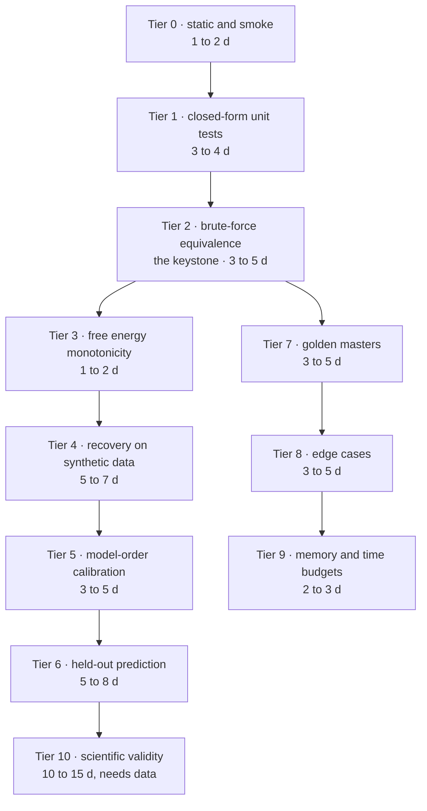
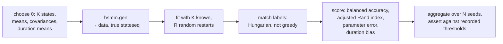

# How to validate this properly

What a serious validation of BSD would look like, in the order it should be built. 15 October 2026,
branch `rev/review`.

## 0. Where it stands today

Measured, not asserted:

- **No test harness.** No `test` or `tests` directory, no `matlab.unittest` classes, no runner.
- The two files named `Test_normal_normal_wishart2.m` and `Test_normal_normal_wishart3.m` are
  scripts, they open with `clear all`, and they sit inside the `+emis_model` package folder where
  MATLAB cannot invoke them through the package prefix. They are also offered to the user as
  selectable emission models. → `ISSUES.md D7`, `H2`
- **No assertions and no input validation** in the model or inference layer. `grep` for `assert(`
  across the repository finds two hits, both inside the vendored `+util/logdet.m`. Every `error(`
  call is in vendored code, in plotting helpers, or copied in with
  `+inference/hmmviterbi.m:65`.
- **No seed control.** Nothing calls `rng`, and the default initialisation is random,
  `program_option.m:8`, so two identical calls do not give the same answer and no result can be
  reproduced exactly. → `ISSUES.md M15`
- The only quality signals present are the free energy printed each iteration,
  `+inference/trainn.m:92`, and the labelling error computed in the tutorial by
  `+util/renameseq.m`, which is itself defective. → `ISSUES.md L10`

So the honest statement is: the toolbox has never been verified, and its accuracy claims rest on
one greedy label matcher applied to one synthetic example.

## 1. Three different questions, usually conflated

Keeping these apart is what makes the plan tractable.

| Question | Name | What answers it | Can it be automated? |
|---|---|---|---|
| Does the code compute the equations it claims? | **verification** | tiers 1 to 3 below, against closed form and brute force oracles | yes, fully |
| Do the equations recover the truth when the truth is known? | **validation** | tiers 4 to 6, synthetic recovery and held out prediction | yes |
| Do the recovered states mean anything about brains? | **scientific validity** | tier 10, reliability and external criteria | partly, and it needs data and a paradigm |

Research code typically attempts only the third and infers the first two. That is backwards: a
failure in tier 2 invalidates every tier 10 result, and tier 2 is a day's work.

---

## 2. Tier 0, static gates and smoke tests

Cheapest possible, and it catches two of the six High issues on its own.

| Test | Assertion | Catches |
|---|---|---|
| `checkcode` on every live file, as a test | no errors, and a reviewed allowlist for warnings | `H1`, as an undefined variable warning |
| **Interface conformance.** For every class in each of the four model packages, instantiate it and assert that every method in `../specs/SPECIFICATION.md` section 3 exists | `ismethod` for each | `H2`, immediately |
| **Package hygiene.** No scripts inside `+package` folders | parse each file, assert it declares `classdef` or `function` | `D7` |
| Smoke: construct an `hsmm` and an `hmm` with every valid combination of sub-models | construction does not error | model zoo regressions |
| Smoke: train for two iterations on a 200 sample synthetic series | returns, with finite `fe` | `H1`, again |

**Effort 1 to 2 d.** Run it in a pre-commit hook or in CI.

## 3. Tier 1, unit tests against closed form oracles

Every one of these has an answer that can be written down independently of the code.

| Unit | Oracle | Assertion | Catches |
|---|---|---|---|
| `emis_model.*.prob` | `scipy`-style direct evaluation, or MATLAB `logmvnpdf`, with the posterior collapsed to a point by setting a huge Wishart degree and a huge mean precision | the log densities agree to `1e-10` | **`M1`**, the `2*pi` factor, directly |
| `dur_model.*.prob` | hand evaluated truncated Gaussian and lognormal on `1:dmax` | agrees, **and** `sum(exp(plog))==1` when the grid is integer | `M9`, and it pins the truncation convention |
| `util.Dirichlet.KLDirich` | Monte Carlo estimate of `E_q[log q − log p]` with 10⁶ draws | within 3 Monte Carlo standard errors | silent KL errors |
| `util.Gamma.klgamma` | as above | as above | the rate versus scale convention, which is easy to get backwards |
| `util.Normal.spm_kl_normal`, `util.Wishart.spm_kl_wishart` | as above | as above | the `%Se debe revisar` note at `+dur_model/lognormal_normal_gamma.m:212` |
| `util.logsumexp`, `logmultmat`, `logsumexpmat` | naive `log(sum(exp(·)))` on values in `[-20, 20]` | agrees to `1e-12`, and handles an all `-inf` row | numerical plumbing |
| `trans_model.*.expect` | hand computed `psi(α) − psi(Σα)` | agrees, and the diagonal is `-inf` for the zero diagonal class | the deliberate `psi(0)` trick |
| Each `update` | the conjugate update written out by hand for a two state, two sample case with chosen responsibilities | posterior parameters agree to `1e-12` | `L5`, and arithmetic slips in the M step |

**Effort 3 to 4 d.** Note that the KL tests by Monte Carlo are cheap to write and are the only
independent check on four functions that feed the free energy directly.

## 4. Tier 2, the keystone: brute force equivalence

**This is the single most valuable test in this document and it is also the cheapest serious one.**

Take a model small enough to enumerate exhaustively: `m = 2` states, `dmax = 3`, `T = 6` samples,
one dimensional Gaussian emissions, parameters fixed by hand. Enumerate **every** segmentation of
six samples into runs of length 1 to 3 with no two adjacent runs in the same state, there are only
a few dozen. For each, compute the joint probability by multiplying out the initial probability,
the duration probabilities, the transition probabilities and the emission densities, by hand in a
loop with no shared code with the decoder. Then:

| Quantity from the enumeration | Compare against | Tolerance |
|---|---|---|
| `log Σ_z p(x, z)` | `decodevar.loglik` | `1e-10` |
| `p(z_t = k | x)` for every `t` and `k` | `decodevar.gamma` | `1e-10` |
| `p(z_t = i, z_{t+1} = j | x)` | `decodevar.xi` | `1e-10` |
| expected entries into `k` with duration `d` | `decodevar.durcount` | `1e-10` |
| `argmax_z p(x, z)` | `viterbi` output | exact match |

What this one test does:

- It is the only check that the residual time recursion, the scaling, and the duration statistic
  are **jointly** right. The index algebra at `hsmmresidual_decodelog.m:61-72` is correct as far as
  I can tell by hand, but "as far as I can tell by hand" is not a basis for publication.
- It detects `M5` immediately, because `gamma` normalised by its value at `t = 10` cannot match an
  exact posterior, and with `T = 6` the current code cannot even index `t = 10`.
- It forces a decision the code currently leaves implicit: **what happens at the two ends of the
  series.** Is the last segment right censored, that is, allowed to be cut short, and does the
  first segment's duration come from the duration model at all? `decodelog:28` initialises every
  residual duration cell to the initial state probability, which is neither of the obvious
  conventions, and `ASSESSMENT.md` question 2 asks the authors about it. The enumeration cannot be
  written without choosing, and once chosen it is documented forever in a test.
- It is the acceptance gate for any future change, including every item in `MEMORY.md` and the
  whole Python port.

**Effort 3 to 5 d**, most of it in writing the enumerator carefully and in resolving the censoring
convention. Repeat it for the HMM decoder, where the enumeration is even simpler, for another
half day.

## 5. Tier 3, free energy monotonicity

Variational Bayes has a guarantee: with a correct E step and M step on the same model, the free
energy cannot decrease. So it should be an **assertion**, not something to be absorbed.

| Test | Assertion |
|---|---|
| Fit 30 iterations on a 1,000 sample synthetic series, for each combination of the live emission and duration models | `all(diff([out.fedetail.fe]) >= -1e-8)` |
| Same, with the Gaussian duration model specifically | expected to **fail** today, see below |
| Free energy at the exact posterior, on the tier 2 toy model | equals the exact log evidence minus the exact KL, to `1e-10` |

`+inference/trainn.m:97-101` currently detects a decrease and sets `dif=inf` to continue, with the
diagnostic commented out, so this failure is invisible today. `ISSUES.md M9` gives the likely
mechanism: the duration E step uses a renormalised truncated density while the M step uses the
untruncated conjugate update, so the two steps optimise different objectives. **Expect this test to
fail on the first run, and treat that as the test working.**

**Effort 1 to 2 d.**

## 6. Tier 4, recovery on synthetic data

The toolbox already ships the generator, `hsmm.gen`, `hsmm.m:45-79`, so the ground truth is free.

| Metric | Why it, and not accuracy alone |
|---|---|
| Adjusted Rand index of the segmentation | label invariant, so no matcher is needed and no matcher can flatter it |
| Balanced accuracy after Hungarian matching | comparable with the tutorial's number, but without `ISSUES.md L10` |
| Mean absolute error of recovered state means, after matching | catches emission M step errors that the sequence hides |
| **Bias of the recovered mean duration** | the toolbox's whole point. Expected to be biased low by the `dmax` truncation and the three `dmax` coupled priors, `ISSUES.md M13`. Measure the bias as a function of `dmax` and publish the curve |
| Fraction of runs where a state dies, `Nk < 15` | quantifies `ISSUES.md H6` |

Run `N = 50` seeds per configuration, sweep `K ∈ {2,…,6}`, duration mean versus `dmax` ratio
`∈ {0.1, 0.25, 0.5}`, and dimension `∈ {2, 10}`. Report the distribution, not the best run. Assert
on the **median and the 10th percentile**, so a flaky configuration cannot pass by luck.

**Replace `renameseq` for this purpose.** It is greedy, it has eleven hard coded histogram bins, and
it can assign a spurious state the label 10, which collides with a real label 10. Use
`matchpairs`, which is MATLAB's Hungarian solver, on the negated confusion matrix. Half a day, and
it makes every accuracy number in this tier defensible.

**Effort 5 to 7 d**, including the sweep harness and the report.

## 7. Tier 5, is the number of states recovered?

This is the toolbox's headline claim and it has never been tested.

| Test | Assertion |
|---|---|
| Generate with a known `K = 3, 4, 5, 6`, fit with `nstates = 0` so the search runs, 50 seeds each | the modal selected `K` equals the true `K`; report the full distribution |
| Same, with the free energy curve recorded for every candidate `K` | the curve has an interior maximum. If it is monotone increasing, `H6` is confirmed and the selection rule is unsound |
| Same, with `maxitersim = 1` versus `5` | quantifies how much the answer depends on restarts |
| Sanity: data generated with `K = 1`, that is, pure noise | the search should not prefer eight states |

Two known threats this tier measures rather than argues about: the greedy stop at the first dip,
`+inference/train.m:97-99`, and the loss of the complexity penalty when a state is pinned to its
prior, `ISSUES.md H6`. Also note `+inference/train.m:101-109` selects by `fe` values that may be
last iteration rather than best, `ISSUES.md M3`.

**Effort 3 to 5 d.** If this tier fails, every published state count from this toolbox is in
question, which is why it ranks above everything in tier 10.

## 8. Tier 6, held out prediction, the honest model comparison

The free energy is an internal bound and, for the reasons in tiers 3 and 5, not currently
trustworthy. An external criterion does not depend on any of that.

- Split each recording into contiguous folds, or hold out whole blocks or whole subjects, which is
  the harder and more meaningful split.
- Fit on the training part, then compute the **held out log likelihood** by running the forward
  pass only, with parameters frozen.
- Compare state counts and model variants by that number.

This also gives the toolbox something it lacks entirely: a defensible way to choose between an HMM
and an HSMM, and between the Gaussian and the MAR emission families, on the user's own data.

Implementation note: the pieces already exist. `decode` with a full posterior and no M step is a
forward pass with frozen parameters, `trainn.m:26-27`. A `predict` entry point is perhaps 50 lines.

**Effort 5 to 8 d**, including a cross validation driver and a report.

## 9. Tier 7, golden masters

Not a substitute for tiers 1 to 6, but mandatory before any refactor, and the acceptance gate for
the Python port.

- Fix the initialisation by passing a stored state sequence, since seeds cannot be relied on,
  `ISSUES.md M15`. `+util/initvb.m:31-52` already supports `initoption='seqprior'`, which is the
  hook for this.
- For each of the five example datasets, store `fe`, `gamma`, `xi`, `durcount`, the posterior
  parameters and `stateseq` as a reference `.mat`.
- Assert equality to `1e-10` on every subsequent run.

Keep the references under version control, with the commit that produced them recorded in the file.
Regenerate them deliberately, never automatically.

**Effort 3 to 5 d.**

## 10. Tier 8, edge cases and robustness

Every one of these is a real input that a user will eventually supply. None is currently handled,
and there is no input validation anywhere in the model layer.

| Input | Expected behaviour | Today, from reading |
|---|---|---|
| `T < 10` samples, or a short block in a study | clear error or correct result | indexes `gamma(10,:)`, `ISSUES.md M5` |
| `T < dmax` | clear error or correct result | untested, the recursions assume otherwise |
| A constant channel, zero range | clear error | divide by zero in the data based prior, `normal_normal_wishart.m:190` |
| `NaN` or `Inf` in the data | clear error at entry | propagates silently to `'loglik indefinida'`, `decodelog:100-102` |
| `nstates = 1` | work, or refuse clearly | `ma(0)` index error, `ISSUES.md M7` |
| `nstates` greater than the number of segments the initialiser can make | clear error | infinite loop, `ISSUES.md M13` |
| A final run of identical k means labels longer than `dmax` | correct duration count | dimension mismatch crash, `ISSUES.md H5` |
| Training the same object twice | identical result | not idempotent, `ISSUES.md M10` |
| `opt.graf = 1` with a Gaussian emission model | plot or ignore | missing method crash, `ISSUES.md M8` |

**Effort 3 to 5 d**, which includes adding the input validation these tests demand.

## 11. Tier 9, budgets as tests

Turn the numbers in `MEMORY.md` into assertions, so a regression fails a test instead of crashing a
study six months later.

| Test | Assertion |
|---|---|
| One E step on 15,360 samples, 6 states, `dmax = 200` | peak memory under a recorded ceiling |
| A full state search, 2 to 10, on 28 synthetic blocks | peak under a recorded ceiling, and it must not scale with the number of blocks once `MEMORY.md` T1.1 lands |
| Viterbi on 15,360 samples | completes inside a recorded wall clock budget |

**Effort 2 to 3 d.** Use `profile('-memory')` or sample the process working set from the test.

## 12. Tier 10, scientific validity

Only meaningful once tiers 1 to 6 pass. These are the arguments a reviewer of a paper will make.

| Approach | What it demonstrates |
|---|---|
| **Split half reliability.** Fit odd and even blocks separately, match states, correlate topographies | the states are properties of the data, not of the fit |
| **Test retest.** Same subject, different session | stability over time |
| **Surrogate null.** Phase randomised or block shuffled data with matched spectra | the state structure is not an artefact of the spectrum. This is the test most likely to surprise people |
| **External criterion.** A paradigm with known structure: eyes open and closed, stimulus onsets, sleep stages | state occupancy tracks something independently known |
| **Comparison against an established toolbox.** The HMM-MAR toolbox, fitted to the same data | the states are not an artefact of this implementation |
| **Sensitivity to `dmax`, `K`, PCA dimension and preprocessing** | the conclusions survive the arbitrary choices |

**Effort 10 to 15 d** of analysis work, and it needs real data and a paradigm, so it is a research
task rather than an engineering one.

---

## 13. Harness mechanics

- **Framework**: `matlab.unittest`. One class per tier, `tests/tier2_BruteForceTest.m` and so on,
  plus a `tests/runAll.m`. No external dependency.
- **Layout**: a `tests/` folder at the repository root, with `tests/fixtures/` for the golden
  masters and the stored initialisation sequences. Keep it out of the `+package` folders, for the
  reason in tier 0.
- **Runner**: `matlab -batch "results = runtests('tests','IncludeSubfolders',true); assertSuccess(results)"`.
- **CI**: `matlab-actions/setup-matlab` and `matlab-actions/run-tests` on GitHub Actions work, but
  need a licence that permits CI use. If that is not available, a documented local `runAll.m` plus a
  pre-push hook is the honest fallback. Do not pretend to have CI that cannot run.
- **Seeds**: add `opt.seed`, default empty, and call `rng(opt.seed)` at the top of
  `+inference/trainn.m`. Without it, tiers 4, 5 and 7 cannot be written at all. This is the single
  prerequisite change, two lines, and it is `ISSUES.md M15`.
- **Runtime**: tiers 0 to 3 should run in under two minutes, so they can be a pre-commit gate.
  Tiers 4 to 6 are a nightly job.

## 14. Effort, and what order to buy it in

| Tier | Content | Effort | Buys you |
|---|---|---|---|
| 0 | static and smoke | 1 to 2 d | `H1` and `H2` caught automatically, forever |
| 1 | closed form units | 3 to 4 d | `M1`, and independent confirmation of four KL functions |
| 2 | **brute force equivalence** | 3 to 5 d | the decoder is correct, or it is not. Everything else depends on this |
| 3 | free energy monotonicity | 1 to 2 d | `M9` becomes visible rather than masked |
| 7 | golden masters | 3 to 5 d | any refactor, including all of `MEMORY.md`, becomes safe |
| **subtotal, the safety net** | | **11 to 18 d** | **this is the prerequisite for touching anything** |
| 4 | synthetic recovery | 5 to 7 d | the first defensible accuracy numbers the project has had |
| 5 | model order calibration | 3 to 5 d | whether the headline claim, the number of states, holds |
| 8 | edge cases | 3 to 5 d | it stops crashing on real inputs |
| 9 | budgets | 2 to 3 d | memory regressions fail a test |
| 6 | held out prediction | 5 to 8 d | an honest way to compare models |
| **subtotal, engineering validation** | | **29 to 46 d** | |
| 10 | scientific validity | 10 to 15 d | what a paper reviewer will ask for |

Sequencing advice: buy tiers 0, 1, 2, 3 and 7 **first and together**, about three weeks. That is
the safety net, it is the prerequisite for the memory work and for the Python port, and it converts
four of the six High issues from arguments into failing tests.

## 15. What "validated" would mean, as a checklist

A claim that this toolbox is validated should mean all of the following, and nothing less:

- [ ] Tier 2 passes: the decoder reproduces an exact posterior on an enumerable model, for both the
      HMM and the HSMM, including `gamma`, `xi` and `durcount`.
- [ ] Tier 3 passes without the `dif=inf` guard in place, for every shipped combination of emission
      and duration model.
- [ ] Tier 1 passes: every density and every KL agrees with an independent oracle.
- [ ] Tier 4 reports a median adjusted Rand index above a recorded threshold across 50 seeds, with
      the duration bias curve against `dmax` published alongside.
- [ ] Tier 5 shows the true state count is the modal choice, with the failure rate stated.
- [ ] Tier 8 passes: no input in that table crashes, and every refusal is a clear message.
- [ ] Tier 7 golden masters exist for all five examples, with the producing commit recorded.
- [ ] `opt.seed` exists, and every number in a paper can be regenerated from a recorded seed and
      commit.
- [ ] Tier 10 split half reliability and a surrogate null are reported for at least one real
      dataset.

Until the first three are ticked, the correct description of the toolbox's status is "unverified",
and that is a statement about the absence of tests, not a judgement on the mathematics.

---

## 16. Issue to test matrix

Answers the "how do I test it?" half of the issues question. Every issue in `ISSUES.md` with the
tier that would catch it and the assertion that would fail.

| Issue | Tier | Test, and the assertion that fails today |
|---|---|---|
| `H1` undefined `ALPHATOTAL` | 0 | smoke train, two iterations, with shipped defaults. Errors |
| `H2` models missing interface methods | 0 | interface conformance over every class in the four packages. `ismethod(mar,'priorfull')` is false |
| `H3` Viterbi memory | 9 | Viterbi on 15,360 samples under a memory and time ceiling |
| `H4` state label gap | 4 | after a fit, `isequal(unique(stateseq), 1:out.nstates)`; and build the tutorial design matrix in the test |
| `H5` `durcount` at `dmax+1` | 8 | k means init on a series whose final run exceeds `dmax`. `size(durcount,1) == dmax` |
| `H6` extinction removes the penalty | 5 | free energy curve over `K` has an interior maximum; and count states with `Nk < 15` |
| `M1` `2*pi` constant | 1 | `prob` against an independent log Gaussian density, point collapsed posterior |
| `M2` documented defaults differ | 0 | parse the tutorial comment block and compare with `program_option`, or simply delete the comment |
| `M3` free energy masking and last not best | 3 | `all(diff(fe) >= -1e-8)`, and `out.fe == max([fedetail.fe])` |
| `M4` tolerance semantics | 1 | assert the documented relative rule, once the team says which rule is intended |
| `M5` normalisation at `t = 10` | 2 | `max(abs(sum(gamma,2) - 1)) < 1e-10`, and the tier 2 toy has `T = 6` |
| `M6` `matixer` typo | 0 | after the GUI writes options, `isfield(opt,'maxiter') && opt.maxiter == entered value` |
| `M7` `minstates = 1` | 8 | `train` with `minstates = 1` either works or errors clearly |
| `M8` `graf` missing | 8 | `train` with `opt.graf = 1` on the default model |
| `M9` duration E step and M step disagree | 3 | monotonicity with the Gaussian duration model. Expected to fail |
| `M10` `cleanpos` field names | 8 | train twice, assert the two results are identical; assert `cleanpos` empties `mean_normal` |
| `M11` `classes_ls` is Windows only | 0 | `numel(classes_ls('emis_model')) > 0`, run on a non Windows agent |
| `M12` `select_eeg_coords` | 8 | a GUI level test, or the one line `disp` check in `ISSUES.md M12` |
| `M13` initialisation can hang | 8 | `nstates` larger than the initialiser can produce, with a timeout |
| `M14` vendored code and licensing | 0 | a licence file exists; a provenance manifest lists every third party file |
| `M15` no seed control | 7 | two runs with the same `opt.seed` give identical `fe`. Cannot be written until `opt.seed` exists |
| `L1` `priorfull` tests the posterior | 1 | set a prior, clear the posterior, assert `priorfull` is true |
| `L2` `in_model.prob` undefined `p` | 0 | call it; or delete it as dead code |
| `L3` lognormal `k1:k1` | 1 | `prob` with `EM` returns `nstates` columns |
| `L4` lognormal `sqrt` | 1 | first M step precision against the hand computed value |
| `L5` `Rk` dead store | 1 | the `update` unit test on the posterior full branch |
| `L6` `pdfdur` zero padding | 2 | Viterbi against brute force on the toy model, where early long durations are reachable |
| `L7` first segment duration uncounted | 1 | `decodevarinit` on a hand built sequence, assert `sum(durcount(:))` equals the number of segments |
| `L8` missing `aux_func` | 0 | call `trainn` with name and value pairs |
| `L9` `Example4` length mismatch | 0 | a fixture check: `size(data,1) == numel(stateseq)` for all five examples |
| `L10` `renameseq` | 4 | replace with `matchpairs` and assert the two agree on clean cases, then keep the Hungarian version |
| `L11` `eta` never returned | 0 | `opt.deceta = 1`, assert `~isempty(decodevar.eta)` |
| `L12` Viterbi backtrace guard | 2 | Viterbi against brute force, plus a case with an unreachable path |
| `L13` Viterbi charges a first transition | 2 | Viterbi against brute force on a two segment series |
| `L14` missing free energy fields on `trouble` | 8 | a stub emission model whose `trouble` returns true on cycle one |
| `D1`–`D7` | 0 | `checkcode`, plus the package hygiene test. Dead code is a warning, not a failure |
