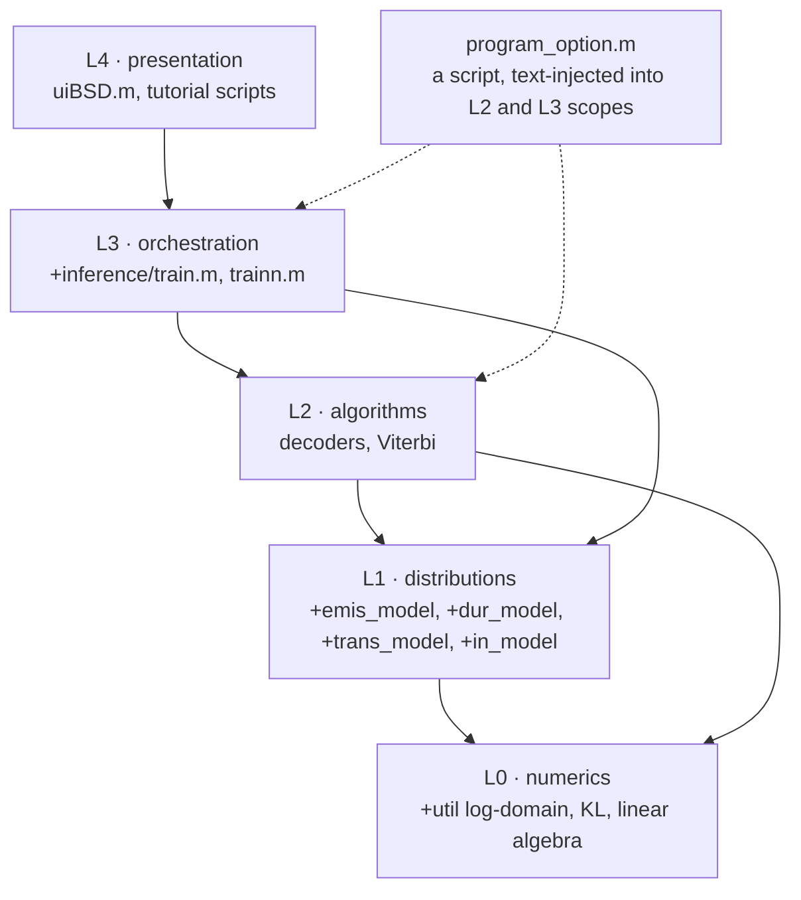
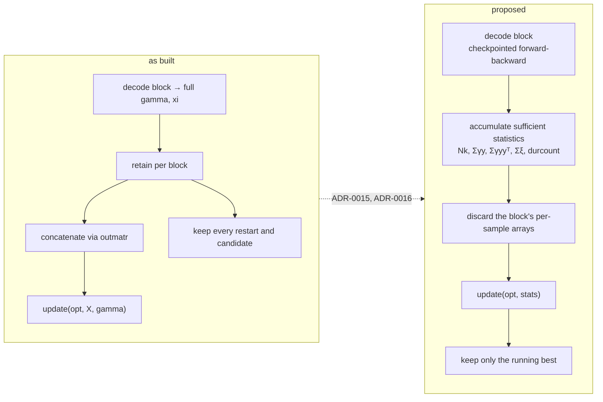

# Design

The architecture of the BSD toolbox, its rationale as far as it can be inferred, and the design
constraints that follow from it. 15 October 2026. Standing: see [`README.md`](README.md).
Decisions are recorded individually in [`adr/`](adr/).

---

## 1. Design goals, inferred

Nowhere stated, but consistently served by the code. Listed in the order the code appears to
prioritise them.

1. **Make the observation model interchangeable.** A new emission family should drop in without
   touching the inference. Served well, see section 3.
2. **Treat parameters as distributions.** Conjugate priors everywhere, posteriors as output, a
   bound on the evidence as the objective. Served.
3. **Let the data choose the number of states.** Served, with the reservations in
   `../review/ISSUES.md H6`.
4. **Support group studies with flexible tying.** Served, and it is the most distinctive feature.
5. **Be usable by a non programmer.** A full GUI and a manual, served, at the cost of a 3,548 line
   class.
6. Not visible as a goal anywhere: testability, memory discipline, reproducibility. The absence is
   consistent, so read it as a priority ordering rather than as an oversight.

## 2. Layering

The layering is clean in one direction, with one defect: **the option script is injected sideways
into both L2 and L3**, so each layer loads its own defaults rather than receiving them. Six files
run `program_option` in their own scope. The consequence is that there is no single place where the
effective configuration of a run exists, which is why `../review/ISSUES.md H1` could happen at all:
a default changed in one file silently broke a consumer two layers away.
See `adr/0012-carry-options-in-a-script-injected-struct.md`.

## 3. Component responsibilities

| Component | Owns | Does not own | Collaborators |
|---|---|---|---|
| `hsmm`, `hmm` | composition of the four sub-models, delegation, the free energy sum | any numerics | `+inference`, the four packages |
| `multimodel` | the block to model mapping, study level decode and free energy | the sharing policy, which is `opt` | `hsmm`, `+util/groupindex` |
| `train` | restarts, the state number search, final sequence extraction, prior filling | one fit | `trainn`, the model |
| `trainn` | one VB run: the loop, convergence, free energy history, the two data shapes | the mathematics of any single update | the four sub-models, the decoders |
| decoders | the E step: `gamma`, `xi`, `durcount`, `loglik` | parameter updates | emission, duration, transition, initial, `+util` log arithmetic |
| each sub-model | its own density, its own conjugate update, its own KL | the loop, the data layout | `+util` KL helpers |
| `+util` | log domain arithmetic, KL divergences, initialisation, block plumbing, plotting | anything model specific | — |
| `uiBSD` | the whole user interface, study persistence, all views | the inference | everything below it |

The separation between `trainn` and the sub-models is the load bearing one, and it holds: no line
in `+inference` names a distribution family. The separation between `uiBSD` and everything else
also holds, which is why the GUI can be left out of a port.

## 4. Key design choices and their consequences

Each links to its decision record.

| Choice | Consequence, good | Consequence, bad |
|---|---|---|
| Four pluggable sub-models behind an informal interface, `ADR-0005` | new models are cheap | nothing enforces the interface, so four shipped classes are unusable, `H2` |
| Residual time HSMM formulation, `ADR-0003` | duration becomes a Markov chain on `m × dmax`, so one recursion covers it | every working array gains a `dmax` axis, which is the root of the memory problem |
| Hard truncation of durations at `dmax`, `ADR-0007` | the state space is finite and the recursion is simple | `dmax` leaks into two priors and the initialiser, `M13`, and all `dmax` slots are carried even where the duration posterior has no mass |
| Log domain with per step scaling, `ADR-0004` | no underflow on long recordings | in the HSMM the final `gamma` step leaves the log domain and exponentiates a full `m × dmax × T` array |
| Free energy for everything: convergence, restarts, state count, `ADR-0008` | one coherent objective, no extra criterion needed | when the bound is wrong, all three jobs fail together, `M1`, `M3`, `M9`, `H6` |
| Per sample statistics in the `update` contract, `ADR-0005` | each sub-model sees everything it might need | memory scales with `T` and with the number of blocks, `MEMORY.md` 4 |
| Retain every restart and candidate, `train.m:53-109` | the caller can inspect all of them | gigabytes retained for results nobody reads, `MEMORY.md` 3 |
| Extinguish weak states by resetting to the prior, `ADR-0013` | numerically stable, avoids singular covariances | removes the state's complexity cost from the free energy, `H6` |
| Handle classes with hand written `copy`, `ADR-0005` | the caller's model object is updated in place | three aliasing concepts, `copy`, `copytrain`, `cleanpos`, and one of them clears the wrong fields, `M10` |
| Sharing by three element vectors, `ADR-0010` | very expressive for little code | the implementation reaches it through `eval` built field access, `D3` |
| One class for the entire GUI, `ADR-0014` | no cross file wiring | 122 nested callbacks, and variable scoping defects such as `M12` |
| Options as an injected script, `ADR-0012` | trivially overridable, no plumbing | no single source of effective configuration, which is how `H1` happened |

## 5. Extension points

Three exist, in descending order of how well they work.

1. **A new emission or duration model.** Add a class to the package, implement the interface in
   `SPECIFICATION.md` section 3. The GUI picks it up automatically by listing the folder, which is
   convenient and is also why test scripts appear in the menus, `H2`.
2. **A new sharing scheme.** Change the three element vectors. No code change needed.
3. **A new initialisation.** Add a branch to `+util/initvb.m`. There is no registry, so this means
   editing a shared file, and `initoption` values are undocumented strings.

Not extension points, though they look like them: `opt.train = 'EM'` is stubbed out in most classes
and dead in the rest; `opt.prepro` has exactly two values; `trouble` is implemented meaningfully
only by the MAR models.

## 6. Design debt, by consequence

What a maintainer would have to confront, ordered by what it costs.

| Debt | Where | Cost it imposes |
|---|---|---|
| No interface enforcement | the four model packages | runtime failures, dead options, `H2`, and it makes every refactor risky |
| Results retained for every candidate fit | `train.m:53-109` | the headline memory problem, `MEMORY.md` 3 |
| Per sample `update` contract | `SPECIFICATION.md` 3.1 | prevents streaming, so memory scales with the study |
| No seam for testing | everywhere | the E step can only be exercised through `train`, which is why `VALIDATION.md` tier 2 needs a toy model rather than a unit test of the recursion |
| Four near duplicate emission families, two near duplicate decoders | `+emis_model`, `+inference` | nobody can tell what is live; every fix must be applied `n` times or deliberately not |
| Options injected by script | six call sites | no single effective configuration, `H1` |
| `eval` built field access | `+util/inmatr.m`, `outmatr.m` | the study path is undebuggable and slow |
| A 3,548 line GUI class | `uiBSD.m` | GUI defects are expensive to find, `M11`, `M12` |
| Dead code left in place | `decodelog:75-79`, `initvb_old.m`, `topograph.asv`, the `D` series | a newcomer cannot distinguish current from abandoned |

## 7. Where the design would go next

This is the reviewer's proposal, not the authors' design. It is the minimum structural change that
removes the memory problem and makes the system testable, and it is deliberately small.

Four decision records cover it: `adr/0015-change-the-update-contract-from-per-sample-arrays-to.md`,
`adr/0016-compute-gamma-with-a-checkpointed-forward-backward-pass.md`, `adr/0017-add-explicit-seed-control.md`,
`adr/0018-introduce-an-abstract-base-class-per-sub-model-family.md`. Costings are in `../review/MEMORY.md` section 5 and
`../review/VALIDATION.md` section 14.

Two properties of that proposal are worth stating, because they are what make it affordable:

- **It does not change the model.** The same posterior, the same free energy, the same answer. So
  it can be gated on the golden masters in `VALIDATION.md` tier 7 rather than on a new scientific
  argument.
- **It is reversible.** The per sample arrays can still be returned on request, behind a flag, for
  the plotting and inspection the GUI does today.
