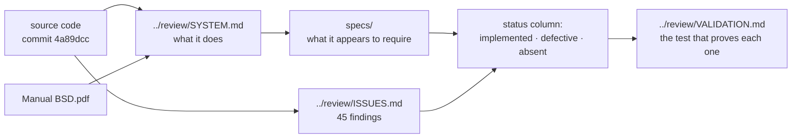

# BSD specifications, reconstructed

This folder contains a specification of the BSD toolbox **recovered from its source code and its
user manual**. It did not exist before 15 October 2026 and it is not an authoritative statement of
the authors' intent.

## Provenance and standing

| | |
|---|---|
| Reconstructed from | source at commit `4a89dcc`, branch `rev/review`, and `Manual BSD.pdf` version 1.0, November 2018 |
| Method | static reading only. MATLAB was unavailable, so **no behaviour was executed** |
| Authority | **none.** Where this folder and the code disagree, the code is the fact and this folder is the bug report |
| Who should correct it | the original authors, named in the manual. Items they alone can settle are listed in `../review/ASSESSMENT.md` section 7 |

Read it as "this is what the system appears to require, as built". It is written in the present
tense for readability, but every statement is an inference from code unless it carries a manual
reference.

## Contents

| File | What it holds |
|---|---|
| [`BUSINESS_RULES.md`](BUSINESS_RULES.md) | the domain rules the model embodies, independent of any implementation |
| [`REQUIREMENTS.md`](REQUIREMENTS.md) | functional and non functional requirements in EARS form, each with its evidence and its implementation status |
| [`SPECIFICATION.md`](SPECIFICATION.md) | the interface contracts: data formats, the four sub-model interface, the option set, the output structures, the algorithms |
| [`DESIGN.md`](DESIGN.md) | architecture, component responsibilities, data flow, and the design constraints that follow |
| [`adr/`](adr/) | eighteen architecture decision records: fourteen reconstructed from the code, four proposed by this review |

## How this folder relates to the review

A requirement marked **defective** in `REQUIREMENTS.md` names the issue in `../review/ISSUES.md`,
and that issue names the test in `../review/VALIDATION.md` section 16. So the chain from
"what it should do" to "what is wrong" to "how to prove it" is complete and traceable in both
directions.

## Conventions

- Requirement identifiers are stable: `REQ-<area>-<nnn>`. Do not renumber.
- Business rules are `BR-<nnn>`, decisions are `ADR-<nnn>`.
- EARS keywords are used strictly: *The system shall* for ubiquitous requirements, *When* for event
  driven, *While* for state driven, *Where* for optional features, *If … then* for unwanted
  behaviour.
- Status values:

| Status | Meaning |
|---|---|
| **Implemented** | the code does this, as far as reading shows |
| **Defective** | the code attempts this and gets it wrong; the issue id is given |
| **Partial** | the code does some of this |
| **Absent** | the requirement is implied by the manual or by the domain, and there is no code for it |
| **Inferred** | the requirement is my reconstruction, with no manual support; treat it as a question for the authors |
